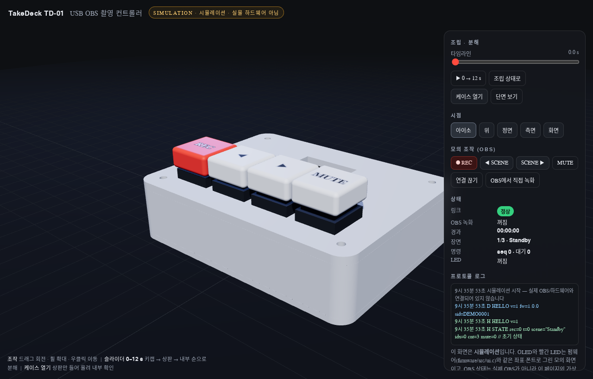

# TakeDeck TD-01 — 조립·플래시·실행 안내

책상 위 USB 촬영 컨트롤러. REC 버튼으로 OBS 녹화를 시작·중지하고, 빨간 LED가 **OBS의 실제
녹화 상태**를 보여주며, 0.96" OLED에 경과 시간·장면·연결 상태가 나온다. 장면 전환·음소거 버튼이 있다.

| | |
|---|---|
| 크기 | 96 × 74 × 24 mm (키캡 포함 높이 약 37 mm) |
| 전원 | USB-C 5 V, 실소비 약 45–60 mA |
| 제어 대상 | OBS Studio 28 이상 (obs-websocket v5) |
| PC 쪽 프로그램 | Python 3.11+ 브리지 (`host/`) |
| 3D 프리뷰 | [`preview/index.html`](preview/index.html) — 브라우저에서 바로 열림 |



---

## 1. 준비물

부품은 [`BOM.csv`](BOM.csv), 배선은 [`WIRING.md`](WIRING.md)와 [`schematic/controller.svg`](schematic/controller.svg).

| 분류 | 준비 |
|---|---|
| 부품 | XIAO RP2040, SSD1306 0.96" I2C OLED, MX 스위치 4개, 5 mm 적색 LED, 220 Ω, 100 nF, 24 AWG 선, M2.5×8 나사 4개, 실리콘 풋 4개 |
| 출력 | FDM 프린터 + PLA/PETG, `enclosure/stl/*.stl` 세 개 |
| 공구 | 인두(300–350 °C), 납, 니퍼, 멀티미터, 드라이버(PH0) |
| 소프트웨어 | `cmake` ≥ 3.13, `ninja`, ARM GNU toolchain 12.3, pico-sdk 1.5.1, Python 3.11+ |

## 2. 3D 프린트

| 파일 | 출력 방향 | 비고 |
|---|---|---|
| `enclosure/stl/bottom_case.stl` | 바닥을 아래로 | 지지대 불필요 |
| `enclosure/stl/top_case.stl` | 스위치 홈이 위로(평평한 면이 아래) | 클립 포켓은 브리징 |
| `enclosure/stl/keycap.stl` | 십자 소켓이 위로 | 4개 출력 (또는 REC만 색 변경) |

권장 설정: 층고 0.2 mm, 외벽 3겹, 채움 20 %, 노즐 0.4 mm.

치수를 바꾸려면 [`enclosure/params.json`](enclosure/params.json)을 고치고:

```bash
cd enclosure
pip install trimesh manifold3d shapely mapbox_earcut numpy
python3 generate.py --render      # STL 재생성 + 간섭 검사 + 미리보기 이미지
```

`takedeck_case.scad`는 같은 파라미터의 OpenSCAD 원본이다(OpenSCAD가 있으면 그쪽에서 직접 편집·출력 가능).
`generate.py`가 두 파일의 수치가 어긋나면 실패한다.

## 3. 배선 (약 40분)

자세한 순서는 [`WIRING.md`](WIRING.md) §3. 요약:

1. 스위치 4개를 상판에 끼우고, 한쪽 다리는 공통 GND, 다른 쪽은 각각 D0·D1·D2·D3로.
2. OLED는 4개 패드에 직접 납땜(헤더 사용 금지 — 케이스 두께 때문에 들어가지 않는다).
3. LED 애노드 → 220 Ω → D6, 캐소드 → GND. 상판 안쪽에서 넣어 4.4 mm 립에 걸리게.
4. XIAO를 케이스 바닥 레일에 끼우고 USB-C가 후면 컷아웃 가운데에 오게 한다.
5. **전원 투입 전** 멀티미터로 3V3–GND 단락 여부와 각 키의 통전을 확인한다.

## 4. 펌웨어 빌드 · 플래시

```bash
export PICO_SDK_PATH=/path/to/pico-sdk-1.5.1      # git submodule(tinyusb) 포함
cmake -S firmware -B firmware/build -G Ninja \
      -DPICO_BOARD=pico \
      -DPICO_TOOLCHAIN_PATH=/path/to/arm-gnu-toolchain-12.3.rel1-x86_64-arm-none-eabi
cmake --build firmware/build
# → firmware/build/takedeck.uf2
```

`PICO_BOARD=pico`를 쓰는 이유: 펌웨어가 RP2040의 GPIO 번호만 직접 쓰고 USB CDC로 통신하므로,
Pico 보드 전용 핀(GP25 LED 등)을 건드리지 않는다. 보드 프로파일은 SDK 빌드용일 뿐이다.

빌드 도구를 설치하지 않고 바로 플래시만 하려면, 이 저장소에 들어 있는 **미리 빌드된 이미지**
`firmware/prebuilt/takedeck.uf2`(이 커밋의 소스로 실제 빌드한 것)를 써도 된다.

**플래시**: BOOT 버튼을 누른 채 USB를 꽂으면 `RPI-RP2` 드라이브가 뜬다. `takedeck.uf2`를 복사하면
자동으로 재부팅한다. (또는 `picotool load -f takedeck.uf2`)

**확인**: 플래시 후 OLED에 `00:00:00 / SCENE -- / WAIT FOR OBS`가 보이면 펌웨어는 살아 있다.
이 시점에는 LED가 1 Hz로 점멸한다(상태를 모른다는 뜻).

## 5. PC 브리지 설치 · 실행

```bash
cd host
python3 -m pip install -r requirements.txt

# OBS: 설정 → WebSocket 서버 설정 → "WebSocket 서버 활성화" (기본 포트 4455)
export TAKEDECK_OBS_PASSWORD='OBS에 설정한 비밀번호'   # 비밀번호를 쓴 경우에만
python3 -m takedeck --list-ports                      # 포트 확인
python3 -m takedeck --mute-input "Mic/Aux"
```

| 옵션 | 설명 |
|---|---|
| `--port` | 시리얼 포트 직접 지정. 생략하면 VID:PID 2E8A:000A + 핸드셰이크로 자동 탐색 |
| `--obs-host/--obs-port` | OBS가 다른 PC/포트에 있을 때 |
| `--obs-password` | OBS 비밀번호. 환경변수 `TAKEDECK_OBS_PASSWORD` 권장 |
| `--mute-input` | MUTE 버튼이 토글할 OBS 오디오 입력 이름 (`"Mic/Aux"` 등) |
| `--ack-cache` | 중복 명령 캐시 파일 (기본 `takedeck-acks.json`, `""`로 끔) |
| `--state-period` | 상태 푸시 주기(초), 기본 0.25 |

브리지는 기기가 사라지면 2초 간격으로 포트를 다시 찾고, OBS가 죽으면 1→15초 백오프로 재접속한다.
둘 다 사람이 손대지 않아도 복구된다.

### OBS 없이 시험하기

```bash
python3 mock_obs.py --port 4455            # 모의 obs-websocket 서버
python3 -m takedeck --port /dev/ttyACM0    # 또는 펌웨어 시뮬레이터와 함께
```

## 6. 동작 확인 (5분)

1. 브리지를 켜면 OLED가 `USB LINK OK / IDLE`로 바뀐다 (LED 소등).
2. **REC** → OBS가 녹화를 시작하고, LED가 **켜지고**, 경과 시간이 올라간다.
3. **REC** 한 번 더 → OBS 중지, LED 소등.
4. **▶/◀** → OBS 장면이 순환한다.
5. **MUTE** → OBS의 해당 입력이 음소거된다 (패널에 `MUTE` 표시).
6. **OBS 창에서 직접 녹화를 시작**해 본다 → 버튼을 누르지 않아도 LED가 켜져야 한다.
7. USB 케이블을 뽑는다 → 3초 뒤(다시 꽂으면) OLED가 `LINK LOST` → `LINKED`로 복구된다.
   브리지 콘솔에는 `device session ... attached`가 다시 찍힌다.

## 7. 문제 해결

| 증상 | 확인 |
|---|---|
| 포트가 안 잡힌다 | **데이터** 케이블인지(충전 전용 아님), `--list-ports`에 2E8A:000A가 보이는지 |
| OLED가 까맣다 | I2C 배선(SDA=D4, SCL=D5)과 모듈 풀업, 3V3·GND. 부팅 시 `ssd1306_present()`가 false면 아무것도 그리지 않는다 |
| 키가 안 먹는다 | 해당 넷의 연속성, 스위치 다리 방향(무극성). 디바운스 15 ms 때문에 아주 짧은 탭은 무시될 수 있다 |
| LED가 계속 점멸 | 링크가 없다는 뜻 — 브리지가 실행 중인지, 권한(pyserial은 `dialout` 그룹 필요할 수 있음) |
| `ERR OBS_DOWN` | OBS WebSocket 서버 활성화 여부, 포트, 비밀번호 |
| 녹화가 두 번 토글된다 | `--ack-cache` 파일을 쓰고 있는지(브리지 재시작 시 중복 차단 유지) |
| 명령이 `BUSY` | 큐(4개)가 가득 참 — 0.7초 안에 5번 이상 누른 경우 |

## 8. 파일 안내

| 경로 | 내용 |
|---|---|
| `REQUIREMENTS.md` | 기능·비기능 요구, 전원 예산, 범위 밖 |
| `ARCHITECTURE.md` | 구조, 프로토콜, 상태 기계, 중복 차단, OBS API 매핑 |
| `BOM.csv` / `HARDWARE_SOURCES.md` | 부품표 / 공식 출처와 근거 |
| `WIRING.md` / `schematic/` | 배선표, 회로도(SVG), 넷리스트 |
| `firmware/` | 펌웨어 소스(pico-sdk), 호스트 테스트, 시뮬레이터 |
| `host/` | Python 브리지, 모의 OBS, pytest |
| `enclosure/` | params.json, .scad, generate.py, stl/, verification.json |
| `preview/` | Three.js 프리뷰 원본·빌드·검사·스크린샷 도구 |
| `docs/` | 치수 출처, CAD/프리뷰 이미지, 검증 로그(`docs/logs/`) |
| `HARDWARE_VERIFICATION.md` | 무엇을 실제로 검증했고 무엇을 못 했는지 |

## 9. 한계 (먼저 읽어 주세요)

이 저장소는 **설계·코드·검증 도구까지** 완성되어 있지만, **실물을 조립·측정한 기록은 없다.**
펌웨어와 브리지는 실제로 컴파일·테스트했고, 케이스는 실제 STL로 생성해 간섭을 계산했지만,
프린터 출력·납땜·OBS 실물 연동·USB 전류 측정은 하지 않았다. 구체적인 목록은
[`HARDWARE_VERIFICATION.md`](HARDWARE_VERIFICATION.md) §5–6에 있다.
